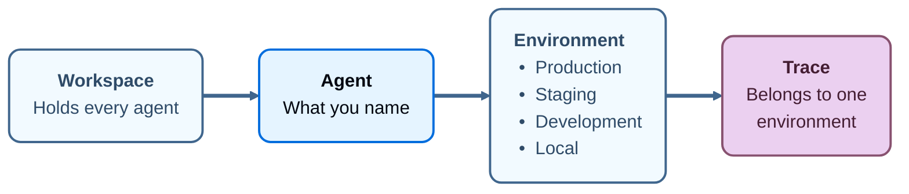

# Agent Registry

> What LangSmith Agent Registry is, what an agent is, how environments divide an agent's traces, and how an identifier differs from a display name.

As an organization builds more agents, it gets harder to know which ones exist and where they run. LangSmith Agent Registry offers a centralized location for registering an agent, providing one place to govern every agent your organization runs, wherever it is hosted. Agent Registry is available on [LangSmith Cloud](cloud.md). Creating an agent registers it, and you can create one in four ways:

* [Build it in the UI](build-an-agent.md).
* [Create it](create-an-agent.md#name-an-agent-traced-from-outside-langsmith) from the **Create a new agent** dialog, for an agent that runs outside LangSmith.
* [Create it with an SDK call or API request](create-an-agent.md#create-an-agent-programmatically).
* [Deploy it](deploy-to-agent-environment.md) through LangSmith.

Once an agent exists, you can [send traces](log-traces-to-agent.md) from anywhere it runs, from any framework that can send traces to LangSmith.

Each agent receives a unique [identifier](#identifiers-and-display-names) that LangSmith uses to address its traces.

The rest of LangSmith attaches to these agents. Datasets, evaluators, deployments, traces, and alerts each attach to an agent in Agent Registry:

LangSmith

> [card] [Build](../build-overview.md)

> [card] [Test](evaluation.md)

> [card] [Deploy](deployment.md)

> [card] [Monitor](observability.md)

> [card] [Agent Registry](#agent)

> [!NOTE]
>
> Agent-based workspaces are available on [LangSmith Cloud](cloud.md). They are not available on [self-hosted](self-hosted.md) LangSmith. To check whether your workspace is agent-based, look at the control at the top left. In an agent-based workspace, it is a workspace switcher that names your workspace. In a [project-based](observability-concepts.md#tracing-projects) workspace, it shows the LangSmith logo.

## Agent

An *agent* is an AI system that completes tasks end to end using tools, skills, and subagents. In LangSmith, an agent is also the unit a workspace is organized around. Name it once, and LangSmith records what that agent does under that name, divided across four [environments](agent-environments.md): Production, Staging, Development, and Local. A trace, an alert, an evaluator, and a prebuilt dashboard each belong to one environment of one agent. A [dataset](evaluation-concepts.md#datasets) and a custom dashboard are the exceptions. A dataset attaches to one or more agents and to no environment, and a custom dashboard attaches to an agent rather than to an environment.

Every trace carries its agent and one of that agent's environments, so what produced a trace and where it ran are recorded as it arrives. LangSmith can then act on that context: an alert watches production and stays quiet about local runs, each environment gets its own prebuilt dashboard, and an [Insights](insights.md) report covers the traffic of the environment you run it on.

### Environments

An *environment* records where an agent was running when it produced a trace. The names are fixed: Production, Staging, Development, and Local.

For more information, see [Agent environments](agent-environments.md).

### Identifiers and display names

Every agent has two names, and they do different work:

* **Identifier**: Set when the agent is created, and not editable afterwards. Whether you supply it or LangSmith generates it depends on [how the agent was created](create-an-agent.md). LangSmith uses it to address traces, so it stays stable even when the display name changes.
* **Display name**: Shown wherever the agent appears in the UI. For an agent [built in the UI](build-an-agent.md), rename it from the **Name** field in its Build configuration. Renaming does not move existing traces or change where new traces land.

The identifier is also what the browser address bar carries, so you can read it from there or copy it from the **ID** field on the agent's Overview.

## Find and govern agents

Once agents are registered, find them and track changes to them from these pages:

* **Find an agent**: The agent switcher moves between the agent list (**All agents**) and a single agent. See [Navigate agents](navigate-agents.md).
* **Audit changes**: [Audit logs](audit-logs.md) record when an agent is created, updated, or deleted, and when an environment is added to it.

## Next steps

> [card] [Environments](agent-environments.md)
>
> The four environments an agent's traces divide into, and how to switch between them.

> [card] [Navigate agents](navigate-agents.md)
>
> The agent switcher, the agent list, and the agent Overview.

> [card] [Log traces to an agent](log-traces-to-agent.md)
>
> How agent addressing sends traces to an agent and an environment, and how to remove conflicting destination settings.

> [card] [Create an agent](create-an-agent.md)
>
> Register an agent before tracing, choose an identifier, and configure its environment.

***

[Connect these docs](../use-these-docs.md) to your agent of choice via MCP for real-time answers.

[Edit this page on GitHub](https://github.com/langchain-ai/docs/edit/main/src/langsmith/agent-registry.mdx) or [file an issue](https://github.com/langchain-ai/docs/issues/new/choose).
