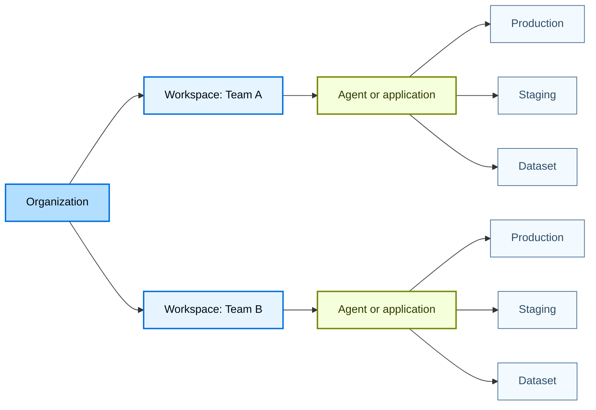
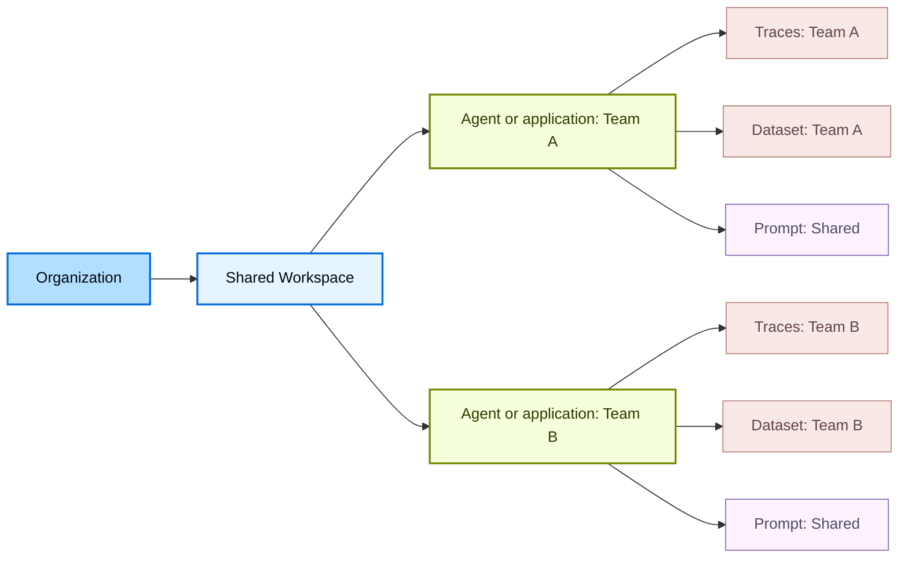

# Workload isolation

LangSmith uses a hierarchical structure to organize your work: [*organizations*](administration-overview.md#organizations), [*workspaces*](administration-overview.md#workspaces), [*agents or applications*](administration-overview.md#agents-and-applications), and [*resources*](administration-overview.md#resources). This structure lets you balance collaboration with access control, allowing you to choose the right level of isolation for your team's needs.

What the grouping level is called depends on which information architecture your workspace uses, and the control at the top left tells you which one you are on. An agent-based workspace groups resources by [agent](agents.md), and each agent's traces divide across [environments](agent-environments.md) drawn from a fixed set of four. A project-based workspace groups them by application instead, with no environment tier, so environments are approximated with separate tracing projects. Agent-based organization is in [beta](release-stages.md). The models below apply to both, and the differences are called out where they matter.

The LangSmith permission system builds on this hierarchy. With [role-based access control (RBAC)](rbac.md), user [permissions](organization-workspace-operations.md) are scoped to one or more workspaces, enforcing isolation between workspaces. With more fine-grained [attribute-based access control](organization-workspace-operations.md#access-policies) (ABAC), access can be further restricted or granted based on attributes such as tags, agents, or applications within a workspace, allowing users to access only development resources or only resources associated with a specific agent or application.

This page explains two common approaches to organizing workspaces based on your team's isolation requirements:

* [Team-centric workspaces](#team-centric-workspaces): Single workspace per team (recommended for most customers)
* [Collaborative workspaces](#collaborative-workspaces): Multiple teams per workspace

> [!TIP]
> For details on setting up organizations and workspaces, refer to [Set up hierarchy](set-up-hierarchy.md).

## Team-centric workspaces

> [!WARNING]
> This is the default model and recommended choice for most customers.

This model (single workspace per team) uses a single organization as the top-level boundary. Within the organization, multiple workspaces are used to isolate different teams or business units. Each workspace represents a logical boundary for a specific team and governs which data and resources that team can access. Within a workspace, teams group the resources that support the same application by agent or by application, depending on the workspace.

In the diagram below, production and staging are an agent's environments in an agent-based workspace, and separate tracing projects in a project-based one.

* **Pros:** A single workspace allows all team resources to be shared, making collaboration and iteration within a team straightforward. It also simplifies promotion from development to production. For example, the same [prompt](prompt-context-hub.md#prompts) can be versioned and promoted to production using tags, without copying or duplication.
* **Cons:** Development, test, and production work coexists in one workspace, so workspace-scoped [RBAC](rbac.md) alone does not separate them. In an agent-based workspace, environments divide an agent's traces without any convention to maintain. In a project-based workspace, separation depends on a naming convention, such as paired projects `checkout-production` and `checkout-staging`. [ABAC](organization-workspace-operations.md#access-policies) provides more granular permissions within a workspace by restricting access based on resource attributes, such as allowing a user to access only development resources.

## Collaborative workspaces

In this model (multiple teams per workspace), multiple teams share a single workspace within an organization and use agents or applications, together with [ABAC](organization-workspace-operations.md#access-policies), to separate resources and govern access. As a result, shared resources such as [prompts](prompt-context-hub.md#prompts) and [deployments](deployment.md) can be reused across teams, while access to sensitive resources like [traces](observability-concepts.md#traces) and [datasets](evaluation-concepts.md#datasets) is limited to the owning team.

* **Pros:** Common resources such as prompts and deployments can be shared and reused across teams, increasing collaboration and reducing duplicated work. Unlike the team-centric workspace model, collaboration is not limited to a single team and can span all teams within the workspace.
* **Cons:** Isolation between teams is weaker than in multi-workspace models and depends on correct use of ABAC. Misconfigured tags or policies can expose sensitive [traces](observability-concepts.md#traces) or [datasets](evaluation-concepts.md#datasets) across teams, and managing permissions across multiple teams adds operational complexity.

***

> [!NOTE]
> [Connect these docs](../use-these-docs.md) to your agent of choice via MCP for real-time answers.

> [!NOTE]
> [Edit this page on GitHub](https://github.com/langchain-ai/docs/edit/main/src/langsmith/workload-isolation.mdx) or [file an issue](https://github.com/langchain-ai/docs/issues/new/choose).
