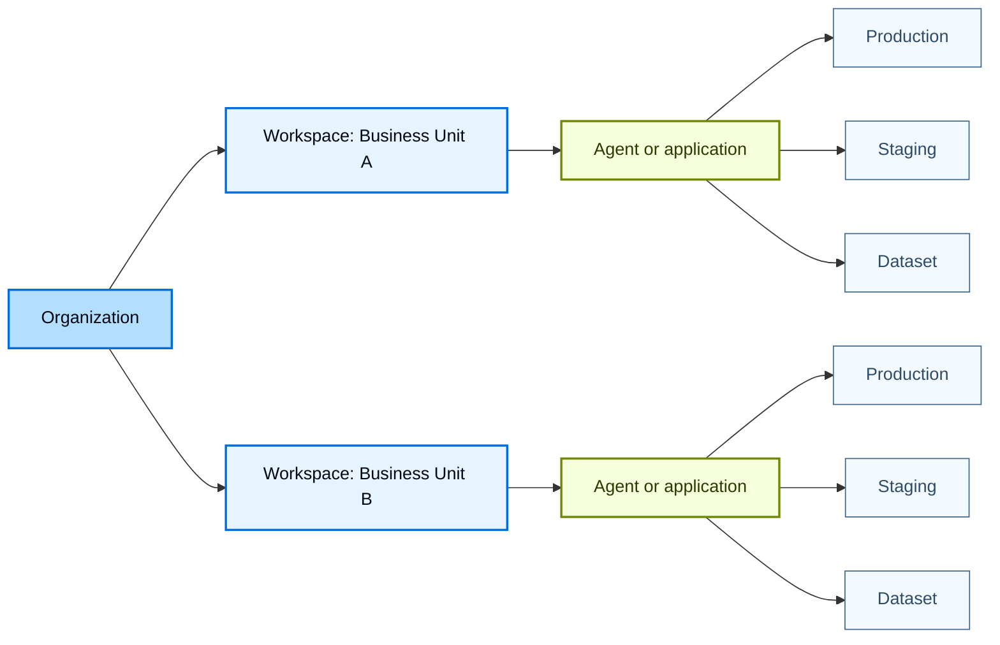
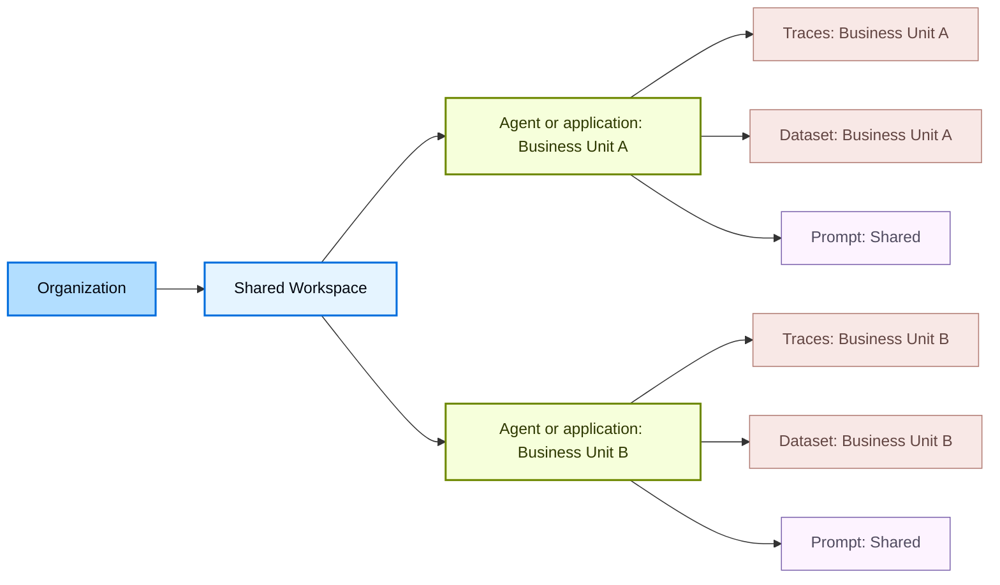

# Workload isolation

LangSmith uses a hierarchical structure to organize your work: organizations, workspaces, agents or applications, and resources. This structure lets you balance collaboration with access control, allowing you to choose the right level of isolation for your organization's needs.

What the grouping level is called depends on which information architecture your workspace uses. The control at the top left tells you which one you are on:

* An agent-based workspace groups resources by [agent](agent-registry.md#agent), and each agent's traces divide across [environments](agent-environments.md) drawn from a fixed set of four.
* A project-based workspace groups them by application instead, with no environment tier, so environments are approximated with separate tracing projects.

The models introduced below apply to both, and the differences are called out where they matter.

This page explains two common approaches to organizing workspaces based on your organization's isolation requirements:

* [Isolate by workspace](#isolate-by-workspace): One workspace per business unit (recommended for most customers)
* [Isolate by agent or application](#isolate-by-agent-or-application): Multiple business units per workspace

> [!TIP]
>
> For details on setting up organizations and workspaces, refer to [Set up hierarchy](set-up-hierarchy.md).

## Control access with RBAC and ABAC

The LangSmith permission system builds on the [resource hierarchy](administration-overview.md#resource-hierarchy):

* With [role-based access control (RBAC)](rbac.md), user permissions are scoped to one or more workspaces, enforcing isolation between workspaces.
* With more fine-grained [attribute-based access control](organization-workspace-operations.md#access-policies) (ABAC), access can be further restricted or granted based on attributes such as tags, agents, or applications within a workspace. For example, ABAC enables restricting access to only development resources or only resources associated with a specific agent or application.

## Isolate by workspace

> [!WARNING]
>
> This is the default model and recommended choice for most customers.

In this model, each business unit in the organization gets its own workspace. The workspace is the isolation boundary: it governs which data and resources that business unit can access. Within a workspace, business units group the resources that support the same application by agent or by application, depending on the workspace.

In the diagram below, production and staging are an agent's environments in an agent-based workspace, and separate tracing projects in a project-based one.

* **Pros:** A single workspace allows all resources belonging to a business unit to be shared within that business unit. This makes collaboration and iteration within a unit straightforward. It also simplifies promotion from development to production. For example, the same [prompt](prompt-context-hub.md#prompts) can be versioned and promoted to production using tags, without copying or duplication.
* **Cons:** Development, test, and production work coexists in one workspace, so workspace-scoped [RBAC](rbac.md) alone does not separate them. In an agent-based workspace, environments divide an agent's traces without any convention to maintain. In a project-based workspace, separation depends on a naming convention, such as paired projects `checkout-production` and `checkout-staging`. [ABAC](organization-workspace-operations.md#access-policies) provides more granular permissions within a workspace by restricting access based on resource attributes, such as allowing a user to access only development resources.

## Isolate by agent or application

In this model, multiple business units share a single workspace within an organization. They use agents or applications, together with [ABAC](organization-workspace-operations.md#access-policies), to separate resources and govern access. As a result, shared resources such as [prompts](prompt-context-hub.md#prompts) and [deployments](deployment.md) can be reused across business units. Access to sensitive resources like [traces](observability-concepts.md#traces) and [datasets](evaluation-concepts.md#datasets) is limited to the owning business unit.

* **Pros:** Common resources such as prompts and deployments can be shared and reused across business units, increasing collaboration and reducing duplicated work. Unlike isolating by workspace, collaboration can span across multiple business units within the workspace.
* **Cons:** Isolation between business units is weaker than in multi-workspace models and depends on correct use of ABAC. Misconfigured tags or policies can expose sensitive [traces](observability-concepts.md#traces) or [datasets](evaluation-concepts.md#datasets) across business units. Managing permissions across multiple business units can add operational complexity.

***

[Connect these docs](../use-these-docs.md) to your agent of choice via MCP for real-time answers.

[Edit this page on GitHub](https://github.com/langchain-ai/docs/edit/main/src/langsmith/workload-isolation.mdx) or [file an issue](https://github.com/langchain-ai/docs/issues/new/choose).
